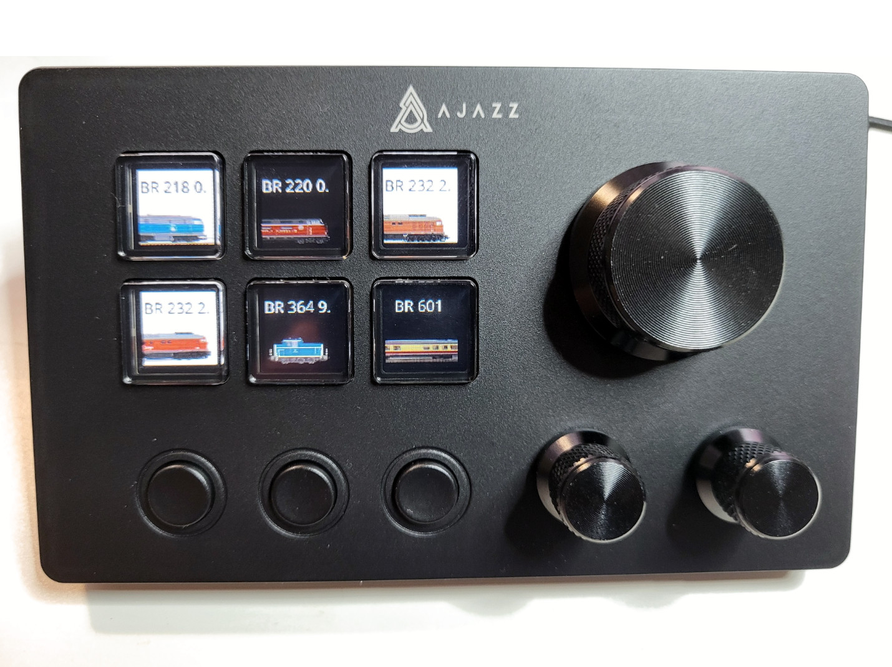
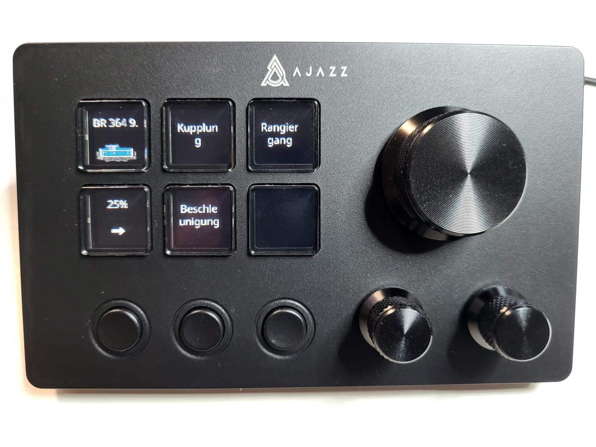
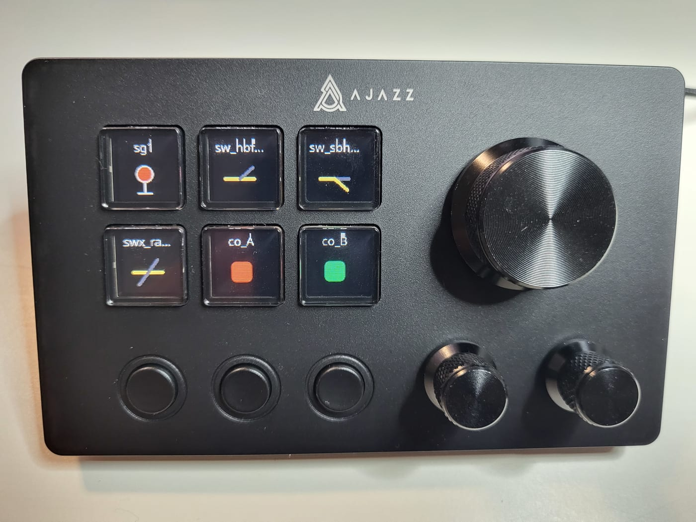
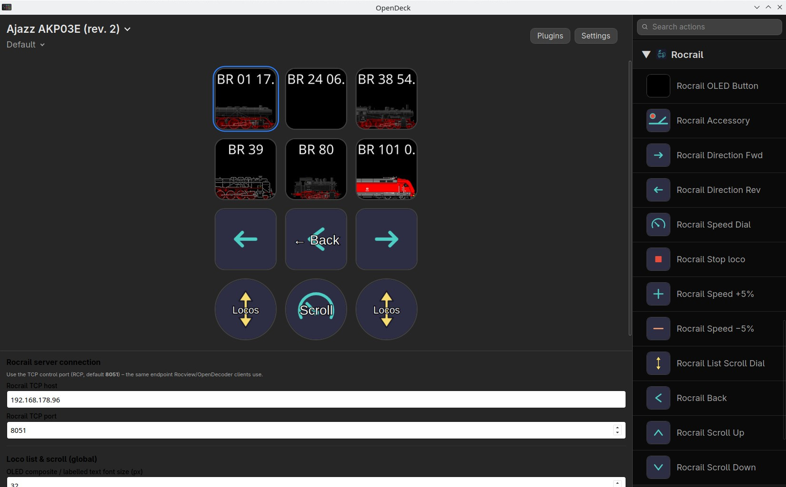

# Rocrail Loco Control – OpenDeck Plugin

OpenAction API plugin for OpenDeck that connects to Rocrail to control model trains using a Stream Deck or any clone supported by OpenDeck.

This is the initial version of the plugin, mainly created with Cursor AI and tested with an Ajazz AKP03E (rev. 2) on Linux.

## Screenshots

**Loco list** — browse the list and pick a locomotive:



**Loco control (throttle)** — control locomotive with streamdeck, speed, light, sound and any other avalibale function:



**Accessory control** — turnouts, signals, sensors, and other plan elements on their own keys:



## Requirements

- [OpenDeck](https://github.com/nekename/OpenDeck)
- [Rocrail](https://wiki.rocrail.net) running with client access (**Client Service**, default port **8051**), http access (**Rocweb**, default port **8080**) and activated **license key**
- Node.js **20 or newer** (If missing, please install it. A restart afterwards might be necessary). Using debian or derivates: *sudo apt install nodejs*

## Build (optional)

1. Install dependencies:
   ```bash
   cd com.marikar.rocrailcontrol.sdPlugin
   npm install
   ```
2. Create archive
   zip -r com.marikar.rocrailcontrol.streamDeckPlugin com.marikar.rocrailcontrol.sdPlugin
   
or just run ```./createPackage.sh```

## Installation

1. Build or download `com.marikar.rocrailcontrol.streamDeckPlugin` from github

2. On OpenDeck go to `Plugins` choose `Install from file` and select the built or downloaded file.

3. Restart OpenDeck.

## Global Configuration

`Rocrail server connection settings` **IP address of the RocRail server** and **TCP port of the Rocrail server** must be set if server does not run on localhost and default port.

`Loco image settings` **HTTP port** and **HTTP path for loco images** must be set if HTTP-Server does not run on default port or images of a subfolder shall be used.


## Button configuration

Multiple devices can be used to control more than one loco at once. For each device a button configuration needs to be set.

For Ajazz AKP03E a recommended configuration is:

- Assign "OLED Button" to all 6 OLED buttons. Define a button to show "loco" in "Throttle view" , define a button to show "speed & direction". Pressing on this button changes the direction.

- Assign "Speed Dial" to dial button. This allows to set speed (turning button) and stop loco (pressing button). In loco list mode it is used to scroll the list. Set scroll mode to "One page per step" if the list of locos is very long.

- Assign "Forward" and "Reverse" to a simple button as well as "Back" to get back from loco control mode (Throttle view) to loco list mode.

- Assign "List Scroll Dial" to a dial button to be able to scroll through functions in loco control mode.



## Debugging

OpenDeck writes one log file per plugin — send it when reporting issues:

- **Linux:** `~/.local/share/opendeck/logs/plugins/com.marikar.rocrailcontrol.log`
- **macOS:** `~/Library/Logs/opendeck/plugins/com.marikar.rocrailcontrol.log`
- **Windows:** `%LOCALAPPDATA%\opendeck\logs\plugins\com.marikar.rocrailcontrol.log`

### Verbose logging (`ROCRAIL_PLUGIN_DEBUG`)

For tricky problems (e.g. jumping speed display) enable verbose logging — it logs the full Rocrail XML traffic including reported speed values. The plugin inherits the variable from OpenDeck's process environment, so start OpenDeck with it set:

- **Linux (native):**
  ```bash
  ROCRAIL_PLUGIN_DEBUG=1 opendeck
  ```
- **Linux (Flatpak):**
  ```bash
  flatpak run --env=ROCRAIL_PLUGIN_DEBUG=1 me.amankhanna.opendeck
  ```
- **Windows:** open `cmd`, run `set ROCRAIL_PLUGIN_DEBUG=1`, then start OpenDeck from that same window.
- **macOS:** start the binary directly — variables do not survive `open`:
  ```bash
  ROCRAIL_PLUGIN_DEBUG=1 /Applications/OpenDeck.app/Contents/MacOS/opendeck
  ```

Keep the debug session short (select a loco, reproduce the issue), then send the plugin log — verbose mode grows the file quickly.

## License

Apache License Version 2.0
